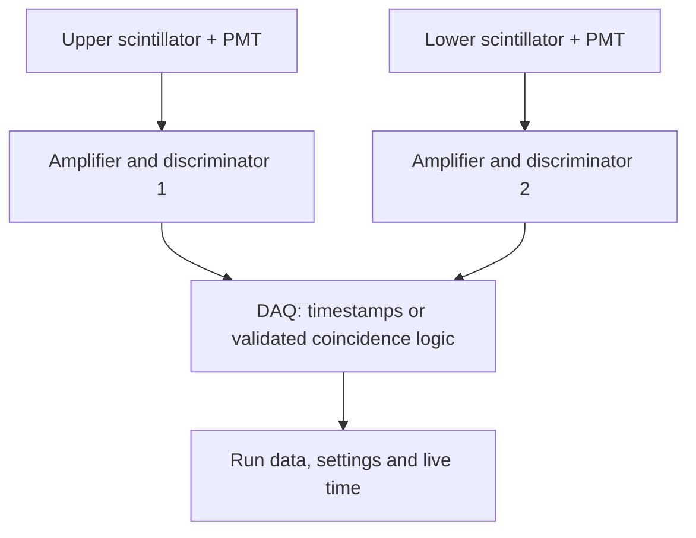
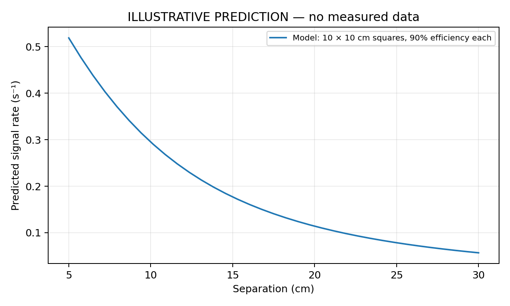
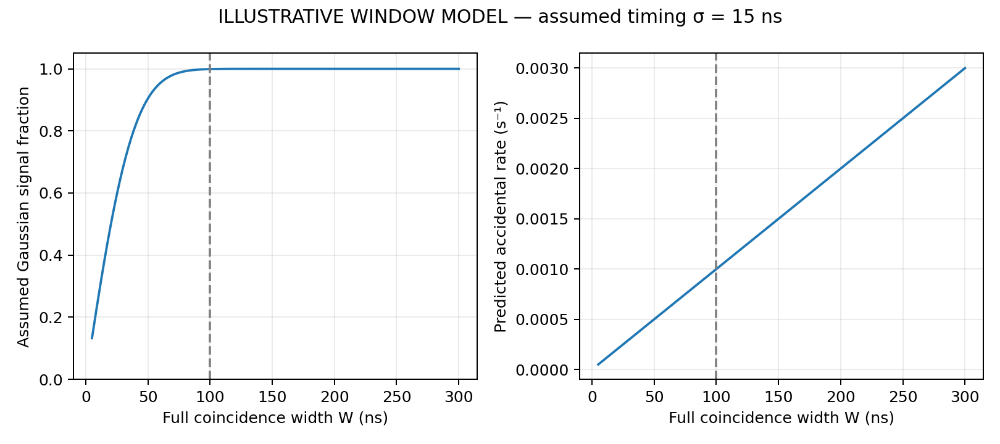

# Worked application: COSMIC-PAIR

> **Fictional teaching example.** No apparatus has been constructed or measured for this application. Prices are invented planning allowances, not quotations. Figures are model predictions. Replace assumptions with evidence in a real submission.

## Cover details

| Field | Entry |
|---|---|
| Project title | COSMIC-PAIR: a two-scintillator telescope for correlated cosmic-ray events |
| Team | Student A (mechanics), B (electronics), C (acquisition), D (analysis), E (coordination and communication); fictional members |
| Host | Department of Physics, University of Tirana |
| Duration | 12 weeks from award; illustrative, subject to the course calendar |
| Funding request | EUR 2,000 |
| Existing resources | Two suitable plastic scintillators, PMTs, compatible bases/HV and departmental DAQ, subject to inventory and booking confirmation |

## 1. Project summary

We propose to construct a reusable two-counter scintillation telescope and investigate whether near-simultaneous signals contain a correlated component beyond random coincidences. Plastic scintillators coupled to photomultipliers will be mounted in a light-tight adjustable frame and connected to the departmental discriminator and counting/timing DAQ. Students will design the supports and optical enclosures, integrate the electronics, implement acquisition, and develop a reproducible analysis. The primary measurement will compare the prompt coincidence rate with a background estimate from displaced timing windows or a validated delayed-coincidence measurement. A secondary measurement will test the predicted dependence of the correlated rate on detector separation, which changes geometrical acceptance. An illustrative acceptance calculation predicts a practicable rate for 10 cm square scintillators. Commissioning will establish signal integrity, threshold stability, effective coincidence width and live time before physics acquisition. The minimum output is a working telescope with a quantitative demonstration of prompt correlations and a documented background estimate. The main output adds a separation scan compared with a finite-area geometrical model. We will deliver equipment, construction files, acquisition and analysis code, data, an operating guide and a scientific poster.

## 2. Scientific question and objectives

Atmospheric cosmic-ray secondaries provide a natural particle population accessible without an artificial source [1]. Two separated counters define a restricted set of trajectories. Independent noise pulses produce accidental coincidences; a correlated excess near the expected relative arrival time provides evidence for particles or correlated processes affecting both counters.

**Question:** Is the prompt rate larger than the accidental rate, and is its separation dependence compatible with a simple through-going cosmic-ray model?

- Minimum: commission two channels and demonstrate a prompt excess of at least five statistical standard deviations using a pre-specified background control; include instrumental cross-talk tests.
- Main: acquire at least 1,000 estimated signal events at each of five separations and compare rates with an acceptance model using one shared normalization.
- Extension: scan discriminator settings and quantify the sensitivity of the measured rate to the chosen operating point.

Coincidence alone does not uniquely identify muons. We will describe events as muon-dominated cosmic-ray candidates where justified, and discuss showers, other secondaries, correlated electronic noise and building overburden. We do not propose measuring particle momentum, absolute muon efficiency or a precision absolute flux.

## 3. Apparatus and construction

Two assumed 10 × 10 × 1 cm plastic scintillator tiles will each be coupled to one existing PMT through an appropriate light guide or coupling fixture. Student-built opaque enclosures will suppress ambient light. A nonmagnetic adjustable frame will hold parallel aligned tiles with nominal mid-plane separation 5, 10, 15, 20 or 30 cm. We will record actual dimensions, alignment and separation uncertainties. Thin-detector ray geometry is used in the initial model; finite thickness and edge response will be assessed before interpretation.

The instructor will confirm PMT operating voltages, base compatibility, polarity, signal levels, DAQ termination, threshold units, input protection, timing range/resolution and dead time. An oscilloscope, if confirmed available, will be booked for signal checks. An MCA is not assumed to supply two-channel timestamps.

If timestamps are exportable, we will save channel, timestamp, timestamp units and rollover information, and run metadata. Otherwise we will save singles and coincidence counts, gates and live time, and validate an implementable delayed-coincidence or gate-width control before relying on it. Acquisition capability is a design-review dependency, not an assumed feature.

The team will build the frame, enclosures and approved cable/interface assemblies, configure DAQ logic/firmware as needed, and write host acquisition and analysis software. Existing amplifiers, discriminators and PMTs will be reused. No magnets, lead plates or radioactive sources are needed.

## 4. Quantitative feasibility and analysis

### Signal estimate

Use an illustrative vertical intensity $I_0=70\ \mathrm{m^{-2}\,s^{-1}\,sr^{-1}}$, motivated by the approximate sea-level scale in [1]. This is a planning assumption, not a local calibration. Define intensity per area normal to the incident direction, integrated over energy, with $I(\theta)=I_0\cos^2\theta$. The angular form is an approximation for this feasibility model, not an exact universal law.

For horizontal square tiles of side $a$ and separation $d$, the overlap for a direction $(\theta,\phi)$ is

$$A_{\rm ov}=\max(a-|d\tan\theta\cos\phi|,0)\max(a-|d\tan\theta\sin\phi|,0).$$

The predicted signal rate is

$$R_s(d)=\epsilon_1\epsilon_2 I_0\int_0^{2\pi}\!\int_0^{\pi/2} A_{\rm ov}\cos^3\theta\sin\theta\,d\theta\,d\phi.$$

The factors include angular intensity, projected area and solid-angle element. We assume independent efficiencies $\epsilon_1=\epsilon_2=0.90$, approximately uniform over each tile. These are unverified inputs. Numerical quadrature in [example_calculations.py](example_calculations.py) produces [the rate table](example_predictions.csv), expected one-hour counts and signal-only Poisson precision. The computed 10 cm rate is approximately **0.295 s⁻¹**, giving roughly **1,062 events/hour** and about **0.94 hours for 1,000 signal events**. Check the generated CSV for precise model values.

| Separation (cm) | Signal rate (s⁻¹) | Expected signal in 1 h | Time for 1,000 signal events (h) |
|---|---:|---:|---:|
| 5 | 0.519 | 1868 | 0.54 |
| 10 | 0.295 | 1062 | 0.94 |
| 15 | 0.177 | 637 | 1.57 |
| 20 | 0.114 | 411 | 2.44 |
| 30 | 0.057 | 204 | 4.89 |

The model requires approximately 10.4 hours total live exposure for the five 1,000-event signal targets, before control runs, repeated references, setup time and any reduced signal capture. We reserve at least three laboratory days for acquisition and controls.

If the actual rate is ten times lower, required exposures grow tenfold. The commissioning review will update the schedule from pilot counts. Minimum scope takes priority over completing every scan point.

### Accidentals and timing

Assume illustrative singles rates $R_1=R_2=100\ \mathrm{s^{-1}}$. Define **W as the full accepted width** in $t_2-t_1$, for example $|t_2-t_1-t_0|<W/2$. For independent stationary low-occupancy streams,

$$R_{\rm acc}\simeq R_1R_2W.$$

For $W=100$ ns, this gives $0.001\ \mathrm{s^{-1}}$, or 3.6 accidentals/hour. The formula's width is not automatically the discriminator pulse width; actual coincidence logic must be characterized. We assume a Gaussian timing spread of 15 ns only to illustrate the signal-window tradeoff below. This value is not a specification of the available DAQ.

We will determine the timing offset, distribution and usable width experimentally. If timing capability cannot resolve the assumed window, we will recompute backgrounds and exposure using the actual width. With equal-width sidebands whose combined width is $kW$, define

$$N_s=N_p-N_b/k,\qquad \sigma_{N_s}=\sqrt{N_p+N_b/k^2}.$$

These expressions assume disjoint independent Poisson windows, stationary background and negligible signal leakage into sidebands. Ten prompt-window equivalents would yield about 36 expected sideband counts in one hour under our assumptions. Low-count significance will use a Poisson on/off likelihood rather than treating a Gaussian significance as exact.

### Analysis and interpretation

The primary result is background-subtracted rate $N_s/T_{\rm live}$ with uncertainty and explicit control evidence. The secondary result compares rates at five separations with the numerical model, fitting a common normalization rather than fixing unknown efficiencies. We will use a Poisson count model with measured exposure and background constraints, examine residuals and report fit quality. Uncertainties will include background, counting, live time, alignment, dimensions and threshold/stability effects; plausible variations of angular shape will assess model dependence.

The two-counter coincidence ratio is not an independent absolute efficiency calibration. A third reference counter or other justified method would be needed for that claim. We will interleave repeated 10 cm reference runs to reveal drift and keep orientation and location fixed. Nearby material/overburden and correlated shower contributions may limit agreement with the simplified model.

## 5. Commissioning and validation

| Test | Method | Planned acceptance / fallback |
|---|---|---|
| Light tightness and signal integrity | Compare normal room-light conditions; inspect signals and clipping | No reproducible light-dependent shift beyond counting uncertainty; repair enclosure if present |
| Channel independence | Inject a safe approved test pulse in one electronic channel with the other detector disconnected/terminated appropriately | No prompt excess attributable to coupling; investigate grounding and wiring if found |
| Timing | Calibrated split test pulse plus actual coincidence timing distribution | Measure effective window and offset; retain a window capturing at least 95% of the established prompt peak where feasible |
| Threshold operating point | Scan thresholds and record singles and coincidences | Choose a reproducible region; assess rate change for ±10% threshold setting; target <5%, otherwise carry measured dependence as a limitation |
| Live time | Check clock against known interval and test counting under controlled pulse rates | Timing scale checked to <1%; quantify losses and corrections at operating rates |
| Stability | Repeated reference runs, log voltages/settings and environmental conditions | Investigate trends exceeding statistical expectations; revise exposures or analysis |
| Background control | Sidebands/delay scan and width scan | Demonstrate a valid off-prompt estimate and test its stationarity; no physics claim until control is credible |

Numerical criteria are targets to test, not achieved specifications. Failure triggers a documented revision or reduced scope.

## 6. Implementation, team and risks

| Work package | Lead / support | Weeks | Evidence |
|---|---|---|---|
| Inventory, design and procurement | E / A, B | 1–2 | Confirmed equipment, drawings, quotations and authorized list |
| Mechanics and optical assembly | A / B, E | 2–4 | Frame, enclosures and assembly record |
| Electronics and acquisition | B, C / A | 2–5 | Approved interfaces, recorded test signals, acquisition version |
| Commissioning | C / all | 5–7 | Checks in section 5 and measurement-readiness review |
| Measurement and analysis | D / C, all | 8–10 | Pilot update, run log, data and reproducible figures |
| Reports and handover | E / all | 11–12 | Scientific/financial reports, poster and operating guide |

Every member will join at least one commissioning session, explain one systematic effect and present part of the final work. Instructor support is requested for equipment selection, HV procedures, interface checks and design reviews; students remain responsible for construction records and analysis.

| Risk | Consequence | Mitigation and owner |
|---|---|---|
| Unavailable or unsuitable PMT/HV/DAQ | Construction or acquisition blocked | Confirm inventory before award; redesign with compatible resources before procurement; B/C |
| Long procurement lead time | Missed schedule | Reuse stock, order early, prioritize minimum scope; E |
| Low or unstable signal | Insufficient scan counts | Pilot exposure update, repair coupling/light leaks, threshold study; A/D |
| Electronic cross-talk or invalid off-prompt control | False correlated signal | Injection/control tests; fix before interpreting prompt excess; B/C |
| HV and tool hazards | Injury/equipment damage | Instructor training, approved enclosed assemblies and supervised initial operation; all |

## 7. Budget and resources

All numbers below are fictional **gross EUR planning allowances**, intended to include taxes where relevant. Delivery/import charges have a separate allowance. Real submission requires dated supplier evidence. Student work and existing equipment are not charged.

| ID | Item | Quantity | Unit EUR | Total EUR | Justification |
|---|---|---:|---:|---:|---|
| B01 | Adjustable frame materials and fabrication | 1 lot | 400 | 400 | Repeatable separation and alignment |
| B02 | Light-tight housings and wrapping | 2 | 150 | 300 | Optical isolation and protection |
| B03 | Optical coupling materials/adapters | 2 | 100 | 200 | Match existing PMTs to tiles |
| B04 | Signal cables, connectors and compatible terminations | 1 lot | 250 | 250 | Safe reproducible interfaces |
| B05 | Approved low-voltage interface PCB/components | 1 lot | 250 | 250 | DAQ integration; not a new HV supply |
| B06 | Consumables and small spares | 1 lot | 150 | 150 | Repair and assembly |
| B07 | Delivery/import cost allowance | 1 lot | 200 | 200 | To be replaced by quoted charges |
| B08 | Controlled reserve | 1 | 250 | 250 | Uncertain adapters or shipping; release requires approval |
| | **Total request** | | | **2,000** | EUR 13,000 below the ceiling |

Institutional contribution: two appropriate plastic tiles and PMTs, compatible bases/HV, DAQ and electronics lab access, computer and instructor guidance, all subject to confirmation. No cash valuation is invented for these resources. If these resources fail verification, we will submit a revised design and budget; the reserve cannot be assumed to buy replacement detectors or a complete HV system.

## 8. Outputs and dissemination

We will deliver the telescope, geometry and wiring records, source code, raw run files, a metadata dictionary, analysis scripts/environment, commissioning evidence, operating guide, final report and a poster/presentation. Each run will record ID, start/end, live time, separation, orientation, HV, thresholds, timing gate, code version, channel counts and anomalies. Public materials will contain financial summaries with receipt IDs; invoices go privately to the instructor.

## 9. References and declarations

1. J.J. Beatty, J. Matthews and S.P. Wakely, **Cosmic Rays**, Particle Data Group review (2022; revised October 2021). [Review PDF](https://pdg.lbl.gov/2022/reviews/rpp2022-rev-cosmic-rays.pdf). Used for cosmic-ray context and approximate flux scale, not a site-specific prediction.
2. S.N. Axani, J.M. Conrad and C. Kirby, **The Desktop Muon Detector: A simple, physics-motivated machine- and electronics-shop project for university students**. [arXiv:1606.01196](https://arxiv.org/abs/1606.01196), [journal DOI](https://doi.org/10.1119/1.5003806). Educational design precedent using SiPMs; our PMT implementation requires its own component design and checks. Historical cost figures are not used as current quotations.
3. Exact departmental scintillator, PMT/base/HV and DAQ manuals: to be identified at inventory review. This is an unresolved technical dependency, not a supplied reference.

The geometrical calculation and example figures are supplied with this teaching package. All team identities and financial records are fictional. This worked example was drafted with AI assistance and requires instructor review before use. A real student team must provide its own declaration and evidence.
